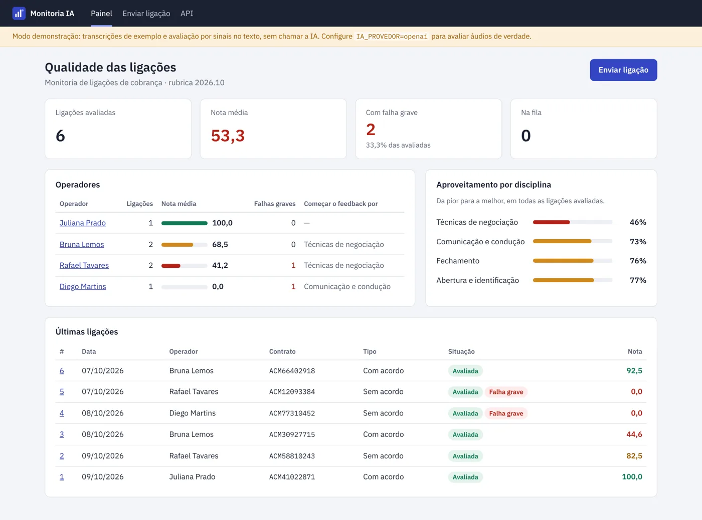
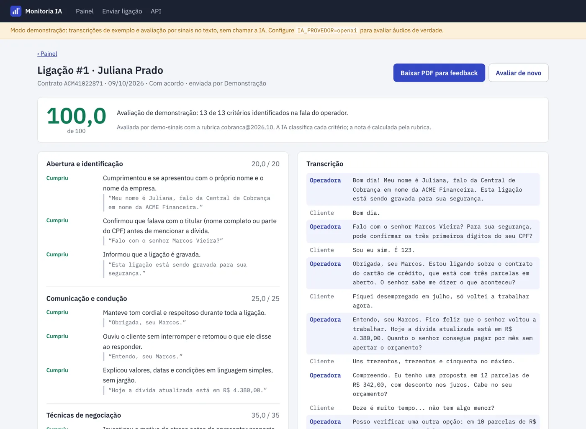
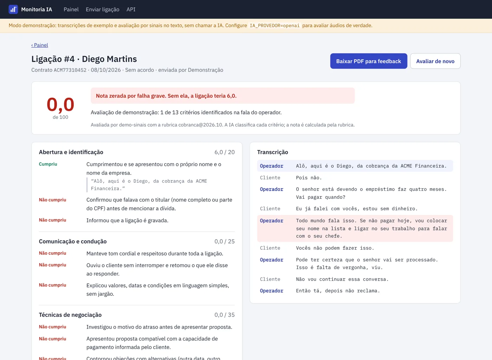

# Monitoria IA

[](https://github.com/wagnerglongo/monitoria-ia/actions/workflows/ci.yml)

Monitoria de qualidade de ligações de cobrança com IA. O supervisor envia a gravação (ou a transcrição), um worker transcreve e avalia a ligação contra uma rubrica de qualidade, e o painel mostra a nota de cada operador, onde cada um mais erra e o trecho exato da ligação que justifica cada ponto. O PDF da avaliação sai pronto para o feedback.



**Stack:** Python 3.11+ · FastAPI · SQLAlchemy 2 · PostgreSQL ou SQLite · Pydantic · OpenAI (saída estruturada) · fpdf2 · pytest · Docker Compose · GitHub Actions

## Como funciona

```text
áudio ou .txt ──► fila (status "pendente")
                     │
                worker reserva a ligação (UPDATE condicional: dois workers nunca pegam a mesma)
                     │
                transcreve ──► grava a transcrição na hora
                     │
                IA classifica cada critério da rubrica: cumpriu / não cumpriu / não se aplica + trecho da ligação
                     │
                Pydantic confere a resposta contra a rubrica (sem critério faltando, inventado ou repetido)
                     │
                rubrica.pontuar() calcula a nota (código determinístico, testado)
                     │
                grava nota, disciplinas, critérios e evidências ──► painel, API e PDF
```

**A IA classifica, o código calcula.** O modelo nunca dá nota: ele diz se cada critério foi cumprido e cita o trecho da transcrição. A nota sai de [`monitoria/rubrica.py`](monitoria/rubrica.py), com pesos por disciplina e por critério, critérios "não se aplica" fora do cálculo e falha grave zerando a ligação. Assim a mesma classificação sempre dá a mesma nota, e mudar um peso não exige mexer em prompt.

**A resposta da IA é validada antes de virar nota.** A chamada usa saída estruturada com um JSON Schema gerado a partir da rubrica (os ids de critério são um `enum`), e a resposta ainda passa por um modelo Pydantic que exige exatamente um item por critério e por falha grave. Resposta fora do formato vira status "erro" e é refeita; não vira número no banco.

**Falhas são esperadas.** Limite de uso, timeout ou resposta inválida deixam a ligação em "erro" com a mensagem, e o worker tenta de novo com espera crescente (1, 2, 4 min...) até o limite configurado. A transcrição é salva assim que fica pronta, então uma nova tentativa da avaliação não paga a transcrição de novo. Ligação presa em "processando" porque o worker morreu volta para a fila sozinha.



## Rubrica

A rubrica fica em [`rubricas/cobranca.json`](rubricas/cobranca.json) e foi escrita para cobrança no Brasil:

| Disciplina | Peso | Critérios |
|---|---|---|
| Abertura e identificação | 20 | apresentação, confirmação do titular antes de falar da dívida (LGPD), aviso de gravação |
| Comunicação e condução | 25 | cordialidade, escuta ativa, clareza em valores e datas |
| Técnicas de negociação | 35 | motivo do atraso, proposta compatível com a renda, contorno de objeções, compromisso com data |
| Fechamento | 20 | recapitulação, canal de envio do boleto, despedida |

**Falhas graves** (zeram a nota): ameaça ou constrangimento (CDC, art. 42), expor a dívida a terceiros, prometer condição não autorizada, linguagem agressiva.

Trocar de operação (SAC, vendas, retenção) é trocar o JSON: o schema da IA, a validação, o cálculo e as telas se adaptam à rubrica carregada.



## Por que saiu do n8n

O projeto começou como um fluxo no n8n que transcrevia os áudios de uma pasta, mandava para um assistente da OpenAI e gravava o resultado no MySQL. Funcionava, mas não tinha como evoluir com segurança:

- As queries eram montadas concatenando o texto devolvido pela IA (`VALUES ('{{ $json.transcription }}')`), ou seja, uma transcrição com aspas quebrava o fluxo e abria espaço para injeção de SQL. Aqui tudo passa pelo ORM, com parâmetros.
- O modelo calculava a própria nota, e o resultado era gravado sem validação. Aqui a IA só classifica, e a resposta é conferida contra a rubrica.
- Uma falha no meio repetia a transcrição inteira e não deixava rastro do erro. Aqui cada etapa é salva e o erro fica registrado na ligação.
- O disparo era manual e não havia teste nenhum. Aqui há um worker contínuo, 44 testes e CI.

O n8n continua útil na ponta: um fluxo que pega gravações do discador e faz `POST /api/ligacoes` é a integração natural.

## Como rodar

### Docker (PostgreSQL, painel e worker)

```bash
cp .env.example .env
docker compose up -d --build
docker compose exec web python -m monitoria demo   # carrega 6 ligações de exemplo e avalia
```

Abra http://localhost:8000. Sem chave de API o sistema roda em **modo demonstração**: aceita transcrições `.txt` e avalia procurando na fala do operador os sinais de cada critério (`sinais_demo` na rubrica). É uma heurística só para a demonstração e os testes andarem sem custo.

Para avaliar áudios de verdade, preencha no `.env`:

```bash
IA_PROVEDOR=openai
OPENAI_API_KEY=...
MONITORIA_SENHA=uma-senha-forte   # obrigatória fora do modo demonstração
```

O worker escala horizontalmente: `docker compose up -d --scale worker=3`.

### Sem Docker (SQLite)

```bash
python -m venv .venv && . .venv/bin/activate
pip install -e ".[dev]"
python -m monitoria demo
python -m monitoria web          # http://127.0.0.1:8000
python -m monitoria worker       # em outro terminal, para processar novos envios
```

### Testes

```bash
pytest
```

Os 44 testes cobrem o cálculo da nota (pesos, "não se aplica", disciplina sem critério aplicável, falha grave), a validação da resposta da IA (critério faltando, inventado, repetido, texto que não é JSON), o pipeline (retentativa sem nova transcrição, limite de tentativas, reserva entre workers, ligação travada), o provedor OpenAI com cliente falso, e a web (upload com conferência do conteúdo real do arquivo, limite de tamanho, CSRF, senha, API JSON, PDF). O CI roda em Python 3.11, 3.12 e 3.13 e sobe o `docker compose` com PostgreSQL para testar o painel e o worker de ponta a ponta.

## API

Documentação interativa em `/api/docs`.

| Método | Rota | |
|---|---|---|
| POST | `/api/ligacoes` | Envia uma ligação (multipart: `arquivo`, `operador`, `contrato`, `tipo`, `data_ligacao`). Exige o cabeçalho `X-Requested-With: monitoria`. |
| GET | `/api/ligacoes` | Últimas ligações (`?operador=` filtra) |
| GET | `/api/ligacoes/{id}` | Nota, disciplinas, critérios com evidência, transcrição |
| GET | `/api/operadores` | Ranking com nota média, falhas graves e disciplina mais fraca |

```bash
curl -u monitor:$MONITORIA_SENHA -H "X-Requested-With: monitoria" \
  -F operador="Juliana Prado" -F contrato=ACM41022871 -F tipo=acordo -F data_ligacao=2026-10-09 \
  -F arquivo=@ligacao.mp3 http://localhost:8000/api/ligacoes
```

## Segurança e privacidade

- Painel e API atrás de HTTP Basic, com comparação em tempo constante; o sistema não sobe com IA real e sem senha.
- Formulários com token CSRF; a API exige um cabeçalho próprio, que outro site não consegue enviar sem CORS.
- Upload conferido pela assinatura do arquivo (não só pela extensão), com limite de tamanho aplicado durante a cópia e nome aleatório, fora de pasta pública.
- CSP sem script nem estilo inline, `X-Frame-Options`, `nosniff`.
- As ligações de exemplo são fictícias, assim como os nomes, contratos e o credor (ACME).

## Estrutura

```text
monitoria/rubrica.py        rubrica e cálculo da nota
monitoria/julgamento.py     formato da resposta da IA, validação e JSON Schema strict
monitoria/ia/               provedores: openai (transcrição + avaliação) e demo
monitoria/pipeline.py       fila, reserva, retentativa
monitoria/web.py            painel e API (FastAPI)
monitoria/relatorio.py      PDF para feedback
monitoria/consultas.py      indicadores e ranking
rubricas/cobranca.json      rubrica de cobrança
exemplos/                   ligações fictícias para a demonstração
tests/                      pytest
```

## Projetos relacionados

- [Pactua, CRM de cobrança](https://github.com/wagnerglongo/crm-cobranca): o call center onde as ligações acontecem.
- [Portal de autoatendimento](https://github.com/wagnerglongo/autoatendimento-cobranca): negociação feita pelo próprio cliente.

## Licença

MIT. Fontes IBM Plex sob a SIL Open Font License.
